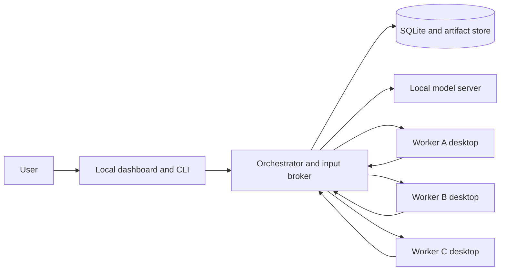

# Local Computer Use

Run a team of local AI agents on one Linux machine. Give them a task, watch each agent use its own browser or desktop applications, and step in when a decision needs you. Agents can exchange findings and hand off an open application while you keep using your own desktop.

**Status** · Design and implementation plan. The initial target is x86-64 Linux with a Wayland host, specifically Hyprland and a 32 GB Tesla V100. The app, supported application list, and performance targets are still to be validated.

## Contents

- [What the app should do](#what-the-app-should-do)
- [Architecture and dependencies](#architecture-and-dependencies)
- [Desktop sessions and input ownership](#desktop-sessions-and-input-ownership)
- [Agent coordination and recovery](#agent-coordination-and-recovery)
- [Model serving and scheduling](#model-serving-and-scheduling)
- [Dashboard and notifications](#dashboard-and-notifications)
- [Data, permissions, and packaging](#data-permissions-and-packaging)
- [Implementation plan](#implementation-plan)
- [Acceptance tests and benchmarks](#acceptance-tests-and-benchmarks)
- [Decisions to validate](#decisions-to-validate)

## What the app should do

1. Accept a prompt or a list of explicitly assigned tasks. Let the user specify a worker count, an application or session template, permitted inputs and destinations, and the desired output. Show the proposed assignments and concurrency.
2. Run independent workers at the same time. Each gets its own model context, app state, display, keyboard, mouse, clipboard, and work directory. A run can have more jobs than the machine can execute at once. Excess work queues.
3. Let workers give one another messages and artifacts. A coordinator can combine findings, report partial results, or assign a follow-up. A worker can hand off a live application session to another worker or the user.
4. Show each worker's status, last meaningful action, live preview, and result. Provide pause, resume, take over, return control, cancel, and stop-all controls. Notify the user when a run finishes or requires attention.
5. Run inference and maintain history locally. Give the user control over network access, imports and exports, persistent app profiles, and retention. Keep the foreground workstation usable while agents work.

**Example run.** Two workers use separate browser sessions to search different parts of a test catalog. They send structured results to a third worker, which opens a native spreadsheet app and produces a shortlist with source links. The user can inspect the active sessions, temporarily take over one browser to resolve an ambiguity, and keep working in Hyprland. The example uses a local fixture with known answers. For an actual marketplace integration, evaluate the provider's API and access requirements. [eBay Browse API](https://developer.ebay.com/develop/api/buy/browse_api/item/search) · [eBay User Agreement](https://www.ebay.com/help/default/default/user-agreement?id=4259)

## Architecture and dependencies

One per-user service owns the job queue, session lifecycle, input arbitration, model calls, permissions, artifacts, and event history. A worker runs a bounded agent loop on the service side. An app and its display run on the session side. Workers communicate through the service. The dashboard and CLI operate on the same state and API. Closing the dashboard has no effect on active jobs.

| Layer | Initial choice | What we build |
| --- | --- | --- |
| Service, CLI, storage | Python 3.11+ with the standard library and SQLite | Process supervision, scheduler, job and session state, model adapter, permissions, event log, and CLI |
| Dashboard | Static HTML, CSS, and JavaScript in the user's browser | Run composer, worker cards, event feed, viewer, and manual control. Use one maintained local HTTP server library if shipping the viewer over HTTP. |
| Desktop runtime | Xvfb, Xauthority, one small X11 window manager, and software rendering | Launch and supervise each private display. Use X11 utilities for the spike. Consider a small helper linked to libX11 and libXtst for capture and input if that removes utility dependencies or improves latency. |
| Isolation | Linux namespaces and cgroups through one qualified rootless runtime | Sandbox policy, guest filesystem and network setup, application templates, quotas, and result export. Evaluate rootless Podman for shipping. Use the installed Bubblewrap only for a narrower offline spike if useful. |
| Inference | One local `llama-server` with a tested multimodal GGUF and matching projector | Thin HTTP client, per-worker context, timeout and concurrency controls, and memory-aware admission |
| Applications | A browser and a native editor or spreadsheet app in the test image | Repeatable application templates and test fixtures. Users select supported apps at launch. |

The base app uses one service, one database, one model endpoint, and one shipping desktop runtime. There is no planned dependency on an agent framework, cloud service, message broker, frontend build chain, or mandatory browser-automation library. Standard-library HTTP is suitable for an offline prototype. The release viewer needs a maintained server and the local boundary described below. Optional integrations earn their place through a specific coverage, latency, or usability improvement. [Python HTTP server documentation](https://docs.python.org/3/library/http.server.html) · [Podman runtime documentation](https://docs.podman.io/en/stable/markdown/podman-run.1.html)

Keep module boundaries small. A desktop session needs launch, observe, apply input, and stop. A model adapter needs health and capabilities, generation with images, and timeout handling. The service owns the rest. Add a second desktop runtime or model adapter after the first completes the full workflow.

## Desktop sessions and input ownership

### Display and app isolation

- Start one authenticated Xvfb display per active session. Start a small window manager for normal focus, dialogs, and window placement. Give each session a predictable initial viewport. Keep resolution and display scale stable during an action.
- Use a private home, application profiles, D-Bus session, XDG runtime and config directories, temporary directory, and downloads workspace. Launch applications from explicit templates. Single-instance applications need to open a new process inside the target session. Otherwise, an existing process can receive a launch request intended for another session.
- Keep X sockets and credentials session-scoped. Route capture and input through the specific session. The runtime must never fall back to an inherited display if a session dies. Host notifications use a separate host-side integration.
- The first app tier is Linux applications that can run as X11 clients in the private display while the user stays on Wayland. Validate the browser, a native editor, and LibreOffice or an equivalent spreadsheet app separately. A Wayland-only application will need a different backend. Evaluate a private Weston compositor and a scoped capture/input path after the X11 workflow works. [X.Org virtual framebuffer](https://www.x.org/X11R6/) · [Weston backends](https://wayland.pages.freedesktop.org/weston/toc/running-weston.html)
- Display isolation keeps focus and input independent. Filesystem, device, IPC, and network isolation come from the rootless sandbox. Use disposable sessions by default. A persistent profile is explicit, gets its own storage, and has one active session at a time. Sign in manually inside the agent session when needed.

An initial probe on the target host created two concurrent Xvfb displays, moved one virtual pointer while the other stayed still, rejected the wrong Xauthority credential, read framebuffer data, and cleaned up both processes. Stage 0 still needs an application-level proof covering capture, focus, clipboard and profile state, and foreground input on the actual Hyprland session.

### Observation and action

- Give the model a bounded screenshot, the image dimensions, the focused window, and a compact history of recent actions. Add semantic UI observations through the guest's AT-SPI bus only when testing shows an improvement. A browser-specific adapter is optional and must operate on the same session and respect the same policy. [Ubuntu accessibility stack](https://ubuntu.com/desktop/docs/en/latest/explanation/accessibility-stack/)
- Start with a typed set of actions for pointer movement and clicks, scrolling, key combinations, text entry, switching or launching permitted apps, waiting, and reporting a result or blocker. Validate model output and targets before dispatch. Keep raw shell commands outside the model's action interface.
- Bind each action to a session, ownership generation, and observation. Map normalized or image-relative coordinates through the exact source frame and reject invalid or stale targets after resize, focus changes, or handoff. Use focused-window identity when available. Capture a fresh frame after actions that change the screen. Bound steps, retries, and time spent waiting.
- Detect stalled loops using repeated actions and unchanged observations. Expose the current blocker, offer manual intervention, and collect a partial result when possible. Handle keyboard layout, scaling, focus changes, modal dialogs, Unicode text entry, and clipboard paste as separate verification cases.

### Sharing a session

Each desktop has a single input owner at any instant. Observers can all look at the same session. The broker alone transfers write ownership between an agent, the user, or a second agent. On pause, takeover, ownership loss, or cancellation, it revokes the previous lease, invalidates queued actions, settles any action already dispatched, and releases held keys and buttons. The new owner gets a fresh observation and a new lease. Returning control to the model follows the same rule.

Agent-to-agent handoff transfers a session handle and a short note through the orchestrator. It leaves the app open and preserves its state. Sharing findings uses messages or copies of artifacts. Shared writable project folders can be evaluated later for apps that support concurrency.

## Agent coordination and recovery

### Jobs and dependencies

- A run contains jobs with goals, dependencies, resource limits, permissions, and output expectations. A coordinator can propose a bounded plan from a natural-language request. The scheduler also accepts explicit assignments so the run can be reproduced without a planning model.
- Start with fan-out and fan-in. Ready jobs enter a fair queue. Dependent jobs become eligible when the declared inputs are ready. Define whether a job requires every input or can proceed with available results. Record failures and incomplete inputs in the final output.
- A worker can send a typed message or artifact reference to the coordinator or another worker in the run. Store sender, recipient, time, provenance, and a size limit. Deliver once per message ID at the application level so retries are safe. Treat the payload as task data. It cannot expand the recipient's capabilities or trigger an implicit command.
- Support explicit worker state and a separate desktop session lifecycle. A job may be queued, starting, running, paused, awaiting input, cancelling, completed, failed, cancelled, or interrupted. A desktop may be provisioning, ready, stopping, stopped, or failed. A paused or waiting job can keep window state without occupying an inference slot.

### Persistence and recovery

Store runs, jobs, session references, events, model capabilities, and artifact metadata in a local SQLite database. Use monotonic event sequence numbers for ordered delivery and dashboard reconnects. Keep large screenshots and exports in a managed directory. Commit a state transition and its event together. Write artifacts to a temporary file, atomically rename them, and make the resulting reference visible only after the write completes. Sweep incomplete or unreferenced files after a crash.

Give sessions a runtime-owned identifier and manage their entire process tree. On restart, reconcile database state with actual sessions and worker ownership. Mark an interrupted action as uncertain if its previous outcome is unknown. A new observation can establish what happened before a human or safe recovery step decides whether to continue. Never promise exactly-once GUI side effects. Cancel cooperatively when possible, then terminate the session's scoped process tree after a short timeout. Clean up only resources owned by that run.

## Model serving and scheduling

### One model, multiple workers

Begin with one model process and separate per-worker conversations. A shared model load lets workers take turns generating while other agents are waiting on UI or network activity. With compatible model and build settings, concurrent requests use separate context and cache slots under the same runtime. Multiple model endpoints and specialized roles can come later. They should compete under the same resource budget.

Use a local OpenAI-compatible inference endpoint with image support and a tested response format. `llama-server` documents multimodal input and parallel serving. A small quantized Qwen3-VL Instruct model and its matching projector are candidates. Compare a smaller and a larger quantized model using completion quality, grounding accuracy, tool format validity, latency, and memory. Pin model and projector revisions, quantization, template, and server build. A scripted model should be enough for service and input integration tests. [llama.cpp server](https://github.com/ggml-org/llama.cpp/blob/master/tools/server/README.md) · [llama.cpp multimodal support](https://github.com/ggml-org/llama.cpp/blob/master/tools/mtmd/README.md) · [Qwen3-VL](https://github.com/QwenLM/Qwen3-VL)

The V100 is compute capability 7.0. For CUDA inference, qualify a build that targets `sm_70` with a compatible CUDA 12.x toolchain. NVIDIA removed Volta compilation and library support from CUDA 13.0. Current vLLM documentation lists a 7.5 minimum, so the baseline uses `llama-server`. Confirm model and projector support, actual GPU offload, available context per slot, and driver compatibility on the target host. [llama.cpp build documentation](https://github.com/ggml-org/llama.cpp/blob/master/docs/build.md) · [NVIDIA CUDA release notes](https://docs.nvidia.com/cuda/archive/13.0.2/cuda-toolkit-release-notes/index.html) · [vLLM GPU requirements](https://docs.vllm.ai/en/stable/getting_started/installation/gpu/)

### Admission and throughput

- Set independent caps for active desktop sessions, in-flight model calls, queued jobs, and per-run workers. Start with one inference slot and benchmark two and three on the same workload. A queued job should avoid allocating a desktop until it is ready to use one. A live desktop waiting for the next observation or for a person need not occupy a model slot.
- Reserve host RAM and VRAM headroom. Track estimated peak memory for model weights, cache, vision inputs, and GUI processes as well as observed usage. Apply cgroup CPU, RAM, and process limits to guest sessions. GPU headroom and responsiveness depend on inference admission and measurement since ordinary CPU and memory cgroups do not cap total GPU use.
- Add backpressure at every stage. Bound screenshot size and rate, event buffers, model context, tokens, artifact bytes, and job duration. Drop stale preview frames when a viewer falls behind. Preserve durable state transitions.
- Optimize the bottleneck found by benchmarks. Reuse current frames during stable UI states, resize screenshots for the model separately from the viewer, compact older history, and batch inference where the backend supports it. When the server is overloaded or the host is under pressure, admit less work and report what is queued. Keep per-worker cancellation responsive even if some GPU work has to finish before its slot frees.

## Dashboard and notifications

- **Run composer** shows the prompt, worker assignments, apps, and limits. Offer a simple mode with just the prompt and worker count, with editable details when needed.
- **Run view** shows worker cards with live thumbnails, current task, last action, ownership, queue reason, and completion status. A timeline shows who acted, what the UI action did, when a handoff happened, and where results came from. Keeping action history distinct from private model reasoning makes the trace easier to read.
- **Session viewer** opens a larger live view inside the dashboard. Start with sampled frames and server-sent events for status, using ordinary request/response calls for commands. Increase preview rate for the selected worker when useful. Include keyboard controls, visible focus, clear stale-frame indicators, and a way to release manual capture. Use a separate video transport only if manual control proves too slow.
- **Intervention** supports pausing a worker, taking over one session, supplying input, and returning control. A reconnect shows the current owner. A lost viewer releases its control lease and leaves the agent paused until the user resumes it. A stop-all command is available from the dashboard and CLI while the queue or model is busy.
- **Notifications and history** show a passive desktop notification for a completed run or needed decision if the user enables it. A notification opens the relevant run when clicked. Record recoverable errors and timeouts in the dashboard. Support keyboard navigation and text status independent of color or motion. [Desktop Notification Specification](https://specifications.freedesktop.org/notification/latest/)

## Data, permissions, and packaging

### Local boundaries

- Keep the service and model on the host. Guests have their own display and bus and access only the files and devices they need. Exclude the host's display sockets, user D-Bus, keyring, personal home, and GPU devices from guest sessions by default. Give the bridge only the capabilities its protocol requires.
- Run first demos with synthetic content and no access to the public internet. Before enabling public browsing, qualify rootless process and filesystem isolation, guest network routing, and denial of host-private services. Use a narrowly configured test network for fixtures. Public tasks must run within their permitted destinations and credentials. Use explicit review for actions such as buying, sending messages, uploading files, or changing account settings where the workflow supports enforceable tool-level controls. A pixel-based controller cannot reliably infer every click's external effect, so qualify limited task surfaces first.
- Treat page text, app content, downloads, and agent messages as untrusted. Keep policy decisions in the service. Escape page- or model-derived text in the dashboard. Do not render it as privileged HTML. Make sensitive input happen in the viewer under user control. Omit typed secrets, cookies, and authorization headers from logging. Offer a private viewing mode that suppresses capture and recording during sensitive entry.
- Keep the CLI on a user-private local socket where practical. Bind the viewer to loopback and authenticate it with a short-lived launch credential and a session. Check Host and Origin, protect mutating requests against cross-origin calls, and bound request size, duration, and connections. Keep the dashboard and model server unreachable from guest workloads. Serve only named app assets and authorized run artifacts.
- Import pinned input copies or specifically scoped read-only files. Export verified files into a chosen destination through the service. Validate path containment and file size, use atomic publication, and define collision behavior. Use per-run retention for screenshots, messages and artifacts, with on-demand purge. Use XDG locations to separate configuration, persistent state, caches, and transient sockets. [XDG Base Directory Specification](https://specifications.freedesktop.org/basedir/)

### Install and operate

- Package the service, CLI, dashboard assets, and sandbox templates as one local application. Start with a reproducible development install, a manual start and stop, and one test distribution on x86-64. Add an optional user service and desktop launcher after the runtime and update path work. Keep installation independent of mandatory root services or automatic driver changes.
- Add a preflight command that reports display backends, isolation and cgroup support, browser and native app availability, disk space, model reachability, and GPU capabilities. Distinguish missing components from a backend that is present but fails isolation checks.
- Pin and document external binaries, images, and model artifacts. Provide versioned configuration and storage migrations, cleanup, and uninstall instructions. Support explicit diagnostics export with paths, credentials, content and raw screenshots omitted or redacted by default. Keep local run data, profiles, model weights, and machine-specific configuration outside the repository.
- Record the project license and third-party notices before distributing builds or images. Model artifacts have their own terms. Ship model downloads or references separately, with integrity metadata, and support use of existing local model files.

## Implementation plan

| Stage | Deliverable | Exit criteria |
| --- | --- | --- |
| 0. Offscreen control spike | Two private Xvfb sessions, fixture apps, capture, scoped input, and shutdown | Input changes only the intended session. Cross-session credentials fail. The host stays usable. Both sessions clean up. |
| 1. Service and dashboard | Local service, CLI, SQLite, job queue, run view, frame viewer, pause and manual takeover | Scripted workers run concurrently. Ownership changes reject stale actions. Viewers reconnect and see correct state. Stop-all works under load. |
| 2. Local model | Thin model adapter and structured observation/action loop | A locally served model completes a browser task and a native app task end to end. Invalid outputs, model loss, cancellation, timeouts, and context limits produce visible states. |
| 3. Coordinated demo | Three-worker run, typed messages and artifacts, result merge, replayable fixtures | Two browsers return distinct results. A third worker uses a native app to produce the expected shortlist. Perform a human takeover and a separate agent handoff. |
| 4. Workstation pilot | Qualified rootless sandbox, explicit file/network policy, persistent profiles, resource controls, notifications, install and diagnostics | Offline and public-network scenarios meet their respective isolation checks. The machine remains usable under the measured concurrency budget. Recovery and teardown leave no unmanaged sessions. |
| 5. Expand coverage | Wayland-only apps, semantic tools, optional endpoint or accelerator support | Add each capability against a named app, benchmark gap, or workflow the baseline cannot cover. |

The shipping pilot is a single-user, single-machine Linux app. Cloud orchestration, multi-user access, unattended account actions, and a cross-platform runtime can be revisited independently after the workstation pilot meets its exit criteria.

## Acceptance tests and benchmarks

| Area | Test |
| --- | --- |
| Foreground safety | With an instrumented foreground test app in Hyprland, inject agent actions during typing, mouse movement, and window switching. Verify that agent actions cause zero host focus, input, and clipboard changes. Monitor host RAM, time to respond to foreground input, and cleanup after a job exits. |
| Session separation | Launch two instances of the same browser and a native application. Use unique cookie, clipboard, app-profile, and file sentinels. Verify separate state, reject cross-session credentials, and prove public-capable guests cannot reach the host's control sockets, model endpoint, private services, or unrelated files. |
| Input ownership | Delay a model response during takeover, resize a display, disconnect the viewer with keys held, and cancel mid-action. Check that stale actions fail, held input releases, reconnect reflects the correct owner, and no session input goes to the host. |
| Coordination | Run the deterministic catalog workflow with duplicate results, one failed worker, and one late message. Verify deduplication, partial-result reporting, bounded retries, and traceable references back to the fixture. |
| Recovery | Kill the orchestrator, model server, and a guest at different points. Reconcile actual processes with stored state, validate artifact integrity, and verify that uncertain side effects require a fresh observation before retry. Run repeated create/cancel cycles and check for leaked processes, sockets and scratch directories. |
| UI | Verify keyboard-only navigation, event ordering after reconnect, stop-all under event backlog, frame staleness, user input handoff, and useful notifications with the dashboard closed. |
| Local operation | Run the offline fixture with external network unavailable. Verify that the app and model continue working and that model failures remain visible. Repeat against a clean install without developer setup. |

Benchmark identical workloads with one, two, and three active desktop sessions and varying inference slots. Measure both cold and warmed runs. Record the fixture revision, model and projector revisions, quantization, slots, context limits, GPU offload, resolution, driver, and desktop baseline. Report task success rate, completed tasks per minute, total batch time, queue wait, action latency, time to first preview, manual input latency, peak VRAM and RAM, and foreground input latency at the median and 95th percentile.

Use scripted workers to isolate runtime overhead, then repeat with the model. The first release decision should compare successful work per minute and host responsiveness against the one-worker baseline. Establish numerical performance budgets after the hardware baseline is measured. Input/clipboard isolation, deterministic test correctness, and cleanup are pass/fail from the start.

## Decisions to validate

| Decision | Evidence needed |
| --- | --- |
| How much of the existing workstation app state to support | Test disposable and reusable agent profiles first. Define any future attach mode around an explicit claim of the selected app or session, with its own interference tests. |
| Runtime and GUI coverage | Verify one rootless runtime under Hyprland, including user namespaces, cgroups, private D-Bus, GUI toolkit compatibility, network policy and process cleanup. Document supported apps and X11 versus Wayland requirements. |
| Smallest good local model and usable worker count | Benchmark end-to-end task success and foreground performance with a pinned build on the V100. Pick the smallest model that meets the quality target. |
| Preview transport and input helper | Measure manual-control latency, screenshot CPU cost and viewer throughput. Keep the simpler approach while it meets the measured budgets. |
| Packaging and license | Pick a distribution package, project license, and application image/update policy before the workstation pilot is distributed. |

The first development target is stage 0. Its proof is two offscreen desktops showing independent application state, independent input, and clean teardown while the foreground desktop remains available.
