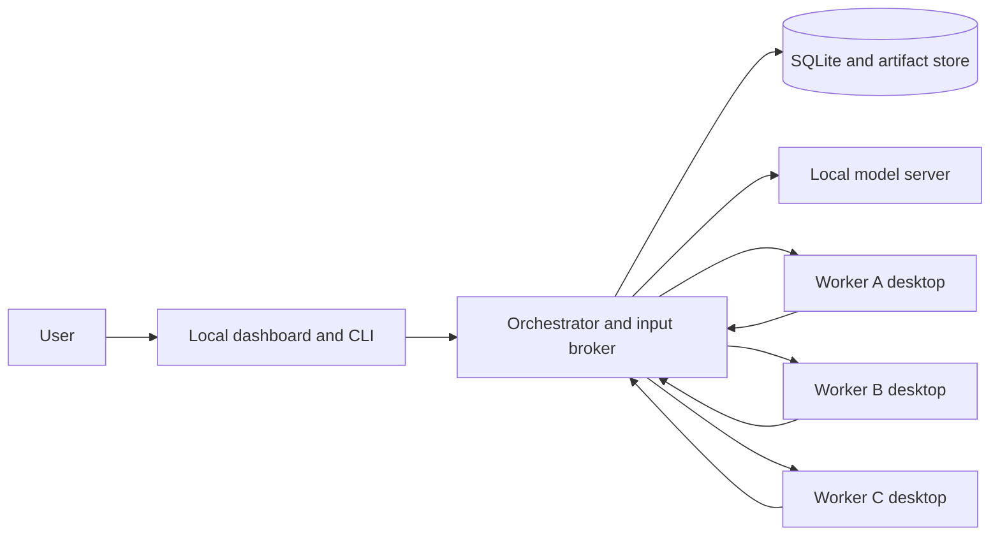

# Parallel Computer Use

Run a team of AI agents from one Linux app. Prompt the team, watch every worker's desktop in a live grid, and step in when a decision needs you. Agents can exchange findings and hand off an open application while you keep using your own desktop. Local models are the default, with optional cloud providers for jobs you explicitly assign to them.

**Status** · Workstation pilot for x86-64 Linux. Development and validation target Hyprland on Wayland and a 32 GB Tesla V100. Worker desktops run X11 applications in private displays. Provider accounts and application coverage vary by setup.

## Run it locally

The core app runs on Python 3.11+ with no third-party Python runtime packages. Install your distribution's Xvfb, X11 and XTEST libraries, Bubblewrap, i3, D-Bus tools, xterm, nano, and xclip. Use Firefox, Chromium, or Google Chrome for browser workers. Enable unprivileged user namespaces for the sandbox. Verify the installed components, then start a scripted run without a model:

```sh
python3 -m parallel_computer_use doctor
python3 -m parallel_computer_use serve --demo
```

Open the one-use loopback link from the terminal. The dashboard lets you enter a prompt, switch between automatic and fixed grid layouts, open a live session, and take manual control. Choose Observe only in a worker assignment to let its model inspect and report without sending input. Close the dashboard to leave the service running. Use `python3 -m parallel_computer_use open` to reconnect, `status` to see worker counts, and `stop-all` to cancel work. Stop the service with Ctrl+C in its launch terminal. The same commands are available under `parallel-computer-use` after `pip install .`.

New installs use `parallel-computer-use` under `$XDG_STATE_HOME` (default `~/.local/state`). Upgrades reuse the previous state folder and its saved profiles if the new folder does not exist. Use the `PCU_` prefix for service environment variables. Existing settings with the previous prefix are accepted as fallbacks.

### Local models

Use a running loopback `llama-server`, or let the app manage one. Configure a compatible vision model and projector. The verified low-resource configuration used the official Qwen3-VL-2B-Instruct Q4_K_M and Q8_0 projector. On Volta, use a tested CUDA 12.x build of llama.cpp targeting compute capability 7.0. [Qwen GGUF files](https://huggingface.co/Qwen/Qwen3-VL-2B-Instruct-GGUF/tree/52d6c8ffea26cc873ac5ad116f8631268d7eb503) · [llama.cpp build guide](https://github.com/ggml-org/llama.cpp/blob/master/docs/build.md)

```sh
python3 -m parallel_computer_use serve \
  --model-file /path/to/Qwen3VL-2B-Instruct-Q4_K_M.gguf \
  --mmproj /path/to/mmproj-Qwen3VL-2B-Instruct-Q8_0.gguf \
  --gpu-device 0 --sessions 3 --inference-slots 2
```

Use `--llama-server /path/to/llama-server` if the executable is outside your path, `--gpu-layers 0` for CPU inference, or `--llama-url http://127.0.0.1:8080/v1 --model MODEL_ID` to use an existing server. The app generates a private loopback API key for managed models. For an existing server that requires a key, provide `PCU_LLAMA_API_KEY` in the service environment.

Start with two inference slots on the tested V100. Choose a lower limit when using the GPU for foreground workloads. Separate desktop and inference caps let agents wait on an app while another agent uses the model.

For aggregate CPU, RAM, and process controls, use a systemd user scope with the model running separately. The following limits the app and worker desktops together.

```sh
systemd-run --user --scope -p CPUWeight=20 -p MemoryHigh=1G -p MemoryMax=2G -p TasksMax=512 \
  python3 -m parallel_computer_use serve --llama-url http://127.0.0.1:8080/v1 --model MODEL_ID
```

### Browser profiles and more applications

Browser jobs open an offline catalog by default. For website access, explicitly configure each permitted hostname with `--allow-domain hostname`, then select a browser start URL in the composer. This path supports HTTPS on port 443 and an exact hostname allowlist. Sites that need additional hosts require explicit configuration of those hosts. Access remains subject to the website's terms. The pilot's network qualification uses a synthetic TLS fixture.

Register reusable private browser profiles with `--browser-profile NAME`. Select a profile in the composer when you want the browser to remember its session. Jobs using the same profile take turns. Profiles use the app's private state directory and do not reuse your personal browser profile. For sensitive manual entry, take control and turn on Private view before typing. Turn it off after dismissing the sensitive screen.

Use `--native-executable /usr/bin/gnome-calculator --native-label Calculator` to add an installed X11-capable app. Use `--config settings.json` to register several apps or local model endpoints. The model can select a registered template in Automatic mode. The application command and arguments always come from the operator's configuration.

```json
{
  "applications": {
    "calculator": {"label": "Calculator", "argv": ["/usr/bin/gnome-calculator"]}
  },
  "local_models": {
    "secondary": {"label": "Secondary local model", "model": "secondary", "url": "http://127.0.0.1:8090/v1"}
  }
}
```

The composer can copy up to four files totaling 256 KiB into each desktop's read-only imports directory. The Results panel lists saved workspace files for download. Set `--notifications` for passive desktop notifications through `notify-send`. With the service stopped, `python3 -m parallel_computer_use prune-history --older-than-days 30 --dry-run` counts eligible runs. Omit `--dry-run` to remove their history, inputs, and workspace files. Browser profiles are kept separately.

### Optional cloud accounts

Codex runs as an optional text worker through OpenAI's documented ChatGPT-plan Responses flow. Install the `codex-auth` extra, connect an eligible account using `codex-login`, then start the app with `--codex-model MODEL_ID`. Use `codex-accounts` to find the account ID if several accounts are connected, and `--codex-account ID` when starting the service. `codex-logout --account ID` clears that connection. Codex's account and inference paths have deterministic fixtures. A live subscription sign-in has yet to be qualified. [OpenAI sign-in guide](https://developers.openai.com/cookbook/articles/sign-in-with-chatgpt) · [Plan inference docs](https://developers.openai.com/siwc/token-sharing-open-source/models-and-inference)

For Gemini, set `PCU_GEMINI_MODEL` and provide `PCU_GEMINI_API_KEY` in the service environment. Billing and quotas belong to your Google Cloud project. The account setting enables a provider option in the composer. Each run still needs explicit consent for cloud workers, and sharing dependency results with other providers takes a separate opt-in. [Gemini API pricing](https://ai.google.dev/gemini-api/docs/pricing)

## Contents

- [What the app should do](#what-the-app-should-do)
- [Architecture and dependencies](#architecture-and-dependencies)
- [Desktop sessions and input ownership](#desktop-sessions-and-input-ownership)
- [Computer-use efficiency](#computer-use-efficiency)
- [Agent coordination and recovery](#agent-coordination-and-recovery)
- [Model serving and scheduling](#model-serving-and-scheduling)
- [Optional Codex and Gemini providers](#optional-codex-and-gemini-providers)
- [Prompting and live worker grid](#prompting-and-live-worker-grid)
- [Data, permissions, and packaging](#data-permissions-and-packaging)
- [Implementation plan](#implementation-plan)
- [Acceptance tests and benchmarks](#acceptance-tests-and-benchmarks)
- [Decisions to validate](#decisions-to-validate)

## What the app should do

1. Accept a prompt or a list of explicitly assigned tasks from the app. Let the user specify a worker count, an application or session template, permitted inputs and destinations, and the desired output. Show the proposed assignments, providers, and concurrency.
2. Run independent workers at the same time. Each desktop worker gets its own model context, app state, display, keyboard focus, mouse pointer, clipboard, and work directory. A run can have more jobs than the machine can execute at once. Excess work queues.
3. Let workers give one another messages and artifacts. A coordinator can combine findings, report partial results, or assign a follow-up. A worker can hand off a live application session to another worker or the user.
4. Show all active workers together in a live grid. Give each worker a preview, status, last meaningful action, and result. Provide pause, resume, take over, return control, cancel, and stop-all controls. Notify the user when a run finishes or requires attention.
5. Run inference locally by default and maintain the app's history on the machine. Allow eligible ChatGPT plan usage for Codex and support a Gemini provider through its official developer API. Give the user control over provider selection, data sent to cloud providers, network access, imports and exports, persistent app profiles, and retention.

**Example run.** Two workers use separate browser sessions to search different parts of a test catalog. They send structured results to a third worker, which uses a native editor to save a shortlist. The user can inspect the active sessions, temporarily take over one browser to resolve an ambiguity, and keep working in Hyprland. The example uses a local fixture with known answers. For an actual marketplace integration, evaluate the provider's API and access requirements. [eBay Browse API](https://developer.ebay.com/develop/api/buy/browse_api/item/search) · [eBay User Agreement](https://www.ebay.com/help/default/default/user-agreement?id=4259)

## Architecture and dependencies



One per-user service owns the job queue, session lifecycle, input arbitration, model calls, permissions, artifacts, and event history. A worker runs a bounded agent loop on the service side. An app and its display run on the session side. Workers communicate through the service. The dashboard and CLI operate on the same state and API. Closing the dashboard has no effect on active jobs.

| Layer | Initial choice | What we build |
| --- | --- | --- |
| Service, CLI, storage | Python 3.11+ with the standard library and SQLite | Process supervision, scheduler, job and session state, model adapter, permissions, event log, and CLI |
| Dashboard | Plain HTML, CSS, and JavaScript with a loopback Python server | In-app prompting, live worker grid, job activity, session viewer, and manual control. |
| Desktop runtime | Xvfb, Xauthority, i3, and software rendering | One X11 connection per private display for input and frame capture via libX11 and libXtst. The launcher ties app and display lifetimes to the service. |
| Isolation | Rootless Bubblewrap with Linux namespaces | Private guest filesystem, D-Bus, input, profiles, and browser networking. The scheduler reserves desktop and inference slots and checks available memory. |
| Inference | One local `llama-server` with a tested multimodal GGUF and matching projector | Thin HTTP client, per-worker context, timeout and concurrency controls, and memory-aware admission |
| Applications | A browser and a native editor or spreadsheet app in the test image | Repeatable application templates and test fixtures. Users select supported apps at launch. |

The base install needs one service, one database, one local model endpoint, and one desktop runtime. The stdlib HTTP server is a single-user loopback interface. It uses an origin-scoped bearer, strict origin checks, and bounded requests. Reassess the HTTP layer before any deployment beyond the local machine. [Python HTTP server documentation](https://docs.python.org/3/library/http.server.html) · [Bubblewrap](https://github.com/containers/bubblewrap)

Keep module boundaries small. A desktop session needs launch, observe, apply input, and stop. A model adapter needs health and capabilities, generation with images, and timeout handling. The service owns the rest. Add a second desktop runtime or model adapter after the first completes the full workflow.

## Desktop sessions and input ownership

### Display and app isolation

- Start one authenticated Xvfb display per active session. Start a small window manager for normal focus, dialogs, and window placement. Give each session a predictable initial viewport. Keep resolution and display scale stable during an action.
- Use a private home, application profiles, D-Bus session, XDG runtime and config directories, temporary directory, and downloads workspace. Launch applications from explicit templates. Single-instance applications need to open a new process inside the target session. Otherwise, an existing process can receive a launch request intended for another session.
- Keep X sockets and credentials session-scoped. Route capture and input through the specific session. The runtime must never fall back to an inherited display if a session dies. Host notifications use a separate host-side integration.
- The first app tier is Linux applications that can run as X11 clients in the private display while the user stays on Wayland. Validate the browser, a native editor, and LibreOffice or an equivalent spreadsheet app separately. A Wayland-only application will need a different backend. Evaluate a private Weston compositor and a scoped capture/input path after the X11 workflow works. [X.Org virtual framebuffer](https://www.x.org/X11R6/) · [Weston backends](https://wayland.pages.freedesktop.org/weston/toc/running-weston.html)
- Display isolation keeps focus and input independent. Filesystem, device, IPC, and network isolation come from the rootless sandbox. Use disposable sessions by default. A persistent profile is explicit, gets its own storage, and has one active session at a time. Sign in manually inside the agent session when needed.

The pilot tests qualify separate authenticated displays, independent app input and clipboard state, Chromium profile isolation and reuse, and process cleanup after broker loss. A real native app fixture computed 6 × 7 in GNOME Calculator and read 42 from its private clipboard.

### Observation and action

- Give the model a bounded screenshot, its coordinate space, and a compact history of recent actions. The broker tracks the focused X11 window. Any future semantic UI observer must operate within the same guest and preserve the same input policy. [Ubuntu accessibility stack](https://ubuntu.com/desktop/docs/en/latest/explanation/accessibility-stack/)
- Start with a typed set of actions for pointer movement and clicks, scrolling, key combinations, text entry, switching or launching permitted apps, waiting, and reporting a result or blocker. Validate model output and targets before dispatch. Keep raw shell commands outside the model's action interface.
- Bind each action to a session, ownership generation, and observation. Map normalized or image-relative coordinates through the exact source frame and reject invalid or stale targets after resize, focus changes, or handoff. Use focused-window identity when available. Capture a fresh frame after actions that change the screen. Bound steps, retries, and time spent waiting.
- Detect stalled loops using repeated actions and unchanged observations. Expose the current blocker, offer manual intervention, and collect a partial result when possible. Handle keyboard layout, scaling, focus changes, modal dialogs, Unicode text entry, and clipboard paste as separate verification cases.

### Sharing a session

Each desktop has a single input owner at any instant. Observers can all look at the same session. The broker alone transfers write ownership between an agent, the user, or a second agent. On pause, takeover, ownership loss, or cancellation, it revokes the previous lease, invalidates queued actions, settles any action already dispatched, and releases held keys and buttons. The new owner gets a fresh observation and a new lease. Returning control to the model follows the same rule.

Agent-to-agent handoff transfers a session handle and a short note through the orchestrator. It leaves the app open and preserves its state. Sharing findings uses messages or copies of artifacts. Shared writable project folders can be evaluated later for apps that support concurrency.

## Computer-use efficiency

Each GUI job opens an app in its own Bubblewrap sandbox and authenticated Xvfb display. The dashboard reads full previews from the service. For inference, a worker takes a model slot, captures the current private desktop, and sends the image with the assignment, recent actions, and relevant messages and results. The model returns one JSON directive. The broker checks the worker's input lease, bounds, and focused X11 window before applying input through XTEST. Each normal decision sees the current image and a short text history. Older screenshots are absent from the prompt.

The built-in Nano worker can type and save the current file in one decision. The broker rechecks focus and ownership between those steps and reports a partial batch if either changes. A fresh image verifies the result. After input, the worker polls for a repaint for up to 120 ms before queueing its next inference. The editor confirms that Nano has painted before handing its first frame to the agent.

The model can request a native-resolution crop for small text or controls. That crop replaces the following model image, with coordinates interpreted relative to what the model sees. The dashboard stays at full view. If a required detail is outside the crop, the model can request the full screen again. A crop can save visual tokens when the projector preserves the smaller dimensions. It also costs an extra observation turn when requested from a full view, so compare whole-task cost and success. Some projector settings, including a configured minimum image-token budget, can erase the token savings. Reducing PNG bytes affects capture and transport at the same dimensions. [Anthropic computer-use image handling](https://platform.claude.com/docs/en/agents-and-tools/tool-use/computer-use-tool) · [llama.cpp projector](https://github.com/ggml-org/llama.cpp/blob/master/tools/mtmd/mtmd-model.cpp)

Local worker state records model requests, screenshot bytes, queue and inference time, and tokens and cache reuse when the backend reports them. The viewer shows calls and token usage. Set the primary local model's optional output cap with `--model-max-tokens` and the llama-server thinking limit with `--model-reasoning-budget`. Extra local providers in the JSON config accept `max_output_tokens` and `reasoning_budget`. The default respects the local model server's reasoning configuration. [llama.cpp timings and context usage](https://github.com/ggml-org/llama.cpp/blob/master/tools/server/README.md#timings-and-context-usage)

In 60 paired measurements on a static 1024 × 768 Nano desktop, median full PNG capture took 5.03 ms, an unchanged-frame check took 3.14 ms, and a quarter-area crop took 1.60 ms. The changed-frame path took 6.83 ms because it checks for change and then encodes the image. The unchanged path omits RGB conversion, PNG encoding, and image transfer.

### Where structured observations help

1. **Use a permitted site API for structured searches.** An eBay listing search can send filters and return item fields directly, leaving the model to compare the results. [eBay Browse API](https://developer.ebay.com/develop/api/buy/browse_api/item/search)
2. **Read the relevant browser elements or native controls.** A guest-local observer can return a bounded list of visible labels, roles, values, and action IDs from the focused page or window. The broker can revalidate IDs before acting. BrowserGym combines element IDs, visibility and layout with screenshots. An OSWorld-Human study found full accessibility trees could add significant observation time and prompt tokens, so cap work by window, node count, text size, and time. [BrowserGym observations](https://arxiv.org/html/2412.05467v1#S3.SS1) · [OSWorld-Human observation study](https://arxiv.org/html/2506.16042v1#S3.SS3) · [Chrome accessibility protocol](https://chromedevtools.github.io/devtools-protocol/tot/Accessibility/) · [Linux AT-SPI](https://gnome.pages.gitlab.gnome.org/at-spi2-core/libatspi/)
3. **Use pixels when layout and appearance matter.** Keep a full screenshot for unfamiliar screens, canvas, visual comparisons, and apps with sparse accessibility data. Use a crop when a detail is too small. Evaluate all routes on verified results, including failed attempts, and compare fresh and cached tokens, inference rounds, and completion time. [OSWorld benchmark](https://arxiv.org/abs/2404.07972) · [OSWorld-G grounding benchmark](https://osworld-grounding.github.io/)

### Comparative computer-use research

Browser and desktop automation have different sources of semantic state. A browser can expose accessibility roles, relationships and names through Chromium and layout and hit testing through the DOM. Native applications expose whatever their toolkit and widgets publish over AT-SPI. Pixels cover both environments, including canvas, and give the agent evidence about appearance and geometry. A permitted application API is preferable when it supplies the exact data or operation the task calls for.

| Approach | What to borrow for this app |
| --- | --- |
| Playwright MCP | Accessible references, scoped snapshots and targeted text search. Its browser actions resolve a locator and check actionability. Keep that contract if the implementation uses a browser-private driver. [Playwright MCP](https://github.com/microsoft/playwright-mcp) · [Playwright actionability](https://playwright.dev/docs/actionability) |
| BrowserGym and Browser Use | BrowserGym links DOM and accessibility observations with shared IDs and viewport metadata. Browser Use's inspected source exposes compact Chromium accessibility state and backend node IDs via a persistent session. Use the accessibility tree for names and semantics, and layout or hit testing for visibility and pointer actions. [BrowserGym observation code](https://github.com/ServiceNow/BrowserGym/blob/62a678f/browsergym/core/src/browsergym/core/observation.py) · [Browser Use accessibility code](https://github.com/browser-use/browser-use/blob/456ff15/browser_use/ax.py) |
| Stagehand | Separate discovering an action from executing it. Replay an established routine only when targets still match and verify the resulting state. Measure actual replay separately from any model-assisted recovery. [Stagehand browser configuration](https://docs.stagehand.dev/v4/configuration/browser) |
| Microsoft Hybrid Computer Use | The Linux provider combines AT-SPI and X11. Its relevant patterns are compact accessibility views, refreshed references, bounded action sequences and post-action feedback. On 360 Linux OSWorld 1.0 tasks with GPT-5.4, the authors report a 70.13% mean task score versus 62.47% for CUA Driver, with 59.1% lower provider cost per task. Both setups also exposed programmatic tools. [Paper, Appendix A](https://arxiv.org/html/2610.41432v1#A1) · [Implementation](https://github.com/microsoft/Hybrid-Computer-Use) |
| UI-TARS and OmniParser | UI-TARS grounds input directly in screenshots. OmniParser preprocesses screenshots into labelled regions. Consider a visual specialist or overlays for difficult visual surfaces after measuring the extra inference and accuracy on this machine. Overlay effects vary by model. [UI-TARS SDK](https://github.com/bytedance/UI-TARS-desktop/tree/main/packages/ui-tars/sdk) · [OmniParser V2](https://www.microsoft.com/en-us/research/articles/omniparser-v2-turning-any-llm-into-a-computer-use-agent/) · [ComponentBench representation tables](https://arxiv.org/html/2608.18307v1) |

For local workers, use text with opaque action references when it covers the task. Bind each reference to the session, active document or application, observation generation and observed target. Resolve it at dispatch, validate its current name, context, identity and actionability, then verify the postcondition. A window-level check cannot catch a button that moves or changes meaning while the same window is focused. A whole-screen equality check would also reject harmless clock or cursor updates. Fall back to pixels or a bounded crop when semantic coverage is insufficient. Send an image and text together when both provide useful evidence. Keep the model's tool surface to typed operations and keep the dashboard on the live desktop.

Measure successful tasks first and report tokens and wall-clock across all attempts. Separate observation time, prompt evaluation, generation, action execution, and verification. Use browser and desktop task sets before generalizing. OSWorld-Human finds planning and reflection dominate many interactive runs. ComponentBench reports that representation rankings vary by model and that Browser Use's richer action space also changes the comparison. OSWorld 2.0 provides resettable long workflows with state-based scoring for later evaluation. [OSWorld-Human v2](https://arxiv.org/html/2506.16042v2) · [ComponentBench](https://arxiv.org/html/2608.18307v1) · [OSWorld 2.0](https://arxiv.org/abs/2606.29537) · [cua-speedrun](https://arxiv.org/html/2609.40284v1)

#### Live browser fixture comparison

The experiment ran Inkling 2 Mini IQ4_NL through the app's llama.cpp adapter on the V100. Chrome 152 opened a temporary headless profile controlled over a private DevTools pipe. Each trial reset its offline page and made one model decision. Two variants each tested a price calculation, choosing between two identically named buttons under different headings, and clicking a control drawn on a canvas. The scorer checked the returned number or read the page state after a real browser input event. The fixture includes a 72-row archive below the viewport.

| Observation and action route | Prices | Duplicate buttons | Canvas | Total reported input | Median per trial |
| --- | ---: | ---: | ---: | ---: | ---: |
| Full screenshot and coordinates | 2/2 | 2/2 | 0/2 | 3,112 | 4.61 s |
| Flattened Chromium accessibility tree and refs | 2/2 | 2/2 | 0/2 | 7,784 | 5.90 s |
| Bounded viewport text and refs | 2/2 | 2/2 | 0/2 | 1,550 | 4.14 s |
| Viewport text, full screenshot and refs | 2/2 | 2/2 | 0/2 | 3,368 | 4.45 s |
| Viewport text and a preselected canvas crop only when present | 2/2 | 2/2 | 2/2 | 1,736 | 4.13 s |

The first comparison used normalized coordinates, a 96-token reasoning budget, a 384-token reply cap, and one warm 6,144-token slot with prompt caching enabled. Reported inputs include reused tokens. Times start after fixture navigation and end after verification. The crop router knew the canvas element's bounds from the page and sent the crop in the first request. The compact view was designed for these fixture tags and action types. These are 30 one-step trials over six fixture states. Longer workflows, cross-origin frames, virtualized lists, and native applications need separate coverage.

A follow-up repeated the click tasks in 24 trials with prompt caching disabled. Both prompts provided the exact image dimensions and named the coordinate units. It held the fixture and sampler settings fixed and alternated the order of coordinate protocols.

| Route | 0–1000 correct | Pixel correct | Total reported input across both |
| --- | ---: | ---: | ---: |
| Full screenshot and coordinates | 3/4 | 3/4 | 3,864 |
| Viewport text and full screenshot | 4/4 | 4/4 | 4,152 |
| Viewport text and crop only for canvas | 4/4 | 4/4 | 1,918 |

On the full screenshot, explicit pixels passed both canvas clicks. Explicit normalized coordinates passed one. The other pixel-mode failure was a reply with valid coordinates and an invented text reference. The harness rejected the ambiguous action. Keep visual coordinates and element references as separate typed actions, and qualify coordinate conventions per model. Full screenshot plus viewport text also passed both canvas variants in the follow-up. The selected crop's advantage here is completing the same tasks with fewer input tokens.

The `--check` run exercises stale reference rejection after a label changes, a modal obscures a button, or an identically labelled element replaces it. The program also records what was clicked so an accepted but wrong click can be distinguished from a missing target.

```sh
python -m scripts.compare_computer_use --check
python -m scripts.compare_computer_use --coordinates legacy \
  --server /path/to/llama-server --gguf /path/to/model.gguf --projector /path/to/mmproj.gguf
python -m scripts.compare_computer_use --no-cache --mode pixels paired routed --task shipping canvas \
  --coordinates normalized pixels \
  --server /path/to/llama-server --gguf /path/to/model.gguf --projector /path/to/mmproj.gguf
```

#### Browser driver and native observations

- **Playwright MCP v0.0.86.** On a local 240-row page, `browser_find` returned 277 bytes with the actionable ref in 38 ms. The full snapshot returned about 23 KB in 34 ms. The scoped result reduced what reaches the model. It still retrieved the page state. A click verified against the fixture succeeded and the old ref was rejected after replacing the node. [Release](https://github.com/microsoft/playwright-mcp/releases/tag/v0.0.86) · [Snapshot semantics](https://playwright.dev/mcp/snapshots)
- **BrowserGym 0.14.3.** Actual frame marking, DOM and accessibility collection, screenshot capture, and full plus viewport tree rendering took a median 268 ms on a 32-row fixture and 3.42 s on a 1,400-row fixture, with eight measurements each. The larger projected tree went from about 424 KB to 2.1 KB after filtering. The real BrowserGym `click(bid)` produced a trusted click and passed the fixture state check. This pipeline does more work than a single browser protocol query. [BrowserGym 0.14.3 observation code](https://github.com/ServiceNow/BrowserGym/blob/v0.14.3/browsergym/core/src/browsergym/core/observation.py)
- **Browser Use 1.0.9.** With `browser-harness` 0.1.13, its real `bu.state()` returned about 3.1 KB at both 32 and 1,400 rows. Warm medians over five calls were 102 ms and 868 ms respectively, including browser readiness checks and worker IPC. The reference click and ensuing automatic observation passed the page's trusted-input and result checks. Output capping alone did little to bound collection on the larger page. [Browser Use source](https://github.com/browser-use/browser-use/tree/456ff150afb8fd09fc32db1a0d4d64bd85c505cd)
- **Stagehand Browse CLI v0.12.0.** On the 1,400-row page the full snapshot was about 365 KB and a filtered snapshot was 201 bytes. Their single-call times were 1.21 s and 1.12 s including CLI startup. The filter runs after snapshot collection. A real reference click and a separate state check passed. This exercised the deterministic CLI path. [Stagehand snapshot implementation](https://github.com/browserbase/stagehand/blob/a64ed2a87f4128a918f8ab2dca6f59f0c5aed1a7/packages/cli/src/lib/driver/commands/snapshot.ts)
- **Collection scope.** On an independent 1,400-row fixture with Playwright 1.65.1 and Chromium 156, median observations across 36 warm measurements were 282 ms for the full Playwright ARIA snapshot, 8 ms for a scoped one, 7 ms for a viewport hit-tested DOM projection, and 39 ms for a screenshot. Collecting the entire tree and filtering it afterward took 412 ms even though the result was only 605 bytes. A separate mutation-aware viewport prototype returned a 14-byte unchanged response in 0.34 ms median, and still rechecked target identity and hit testing before input. It covered the main document, with gaps for frames, shadow DOM, custom listeners and some animations. Partial accessibility enrichment for one known node took 0.41 ms median across 20 warm calls, excluding target discovery. [Chromium accessibility protocol](https://chromedevtools.github.io/devtools-protocol/tot/Accessibility/)
- **Native AT-SPI.** In the app's Bubblewrap/Xvfb environment, an explicitly started private accessibility bus and registry exposed nine visible GTK3 controls in a 502-byte projection. The median was 7.52 ms over 60 observations. Full PNG capture was 5.01 ms and PNG plus Tesseract was 206 ms. A direct accessibility edit and save produced the expected file effect. Two simultaneous guests each saw only its own distinct GTK label and saved its own file. In real GNOME Calculator, walking the broader GTK4 tree took 160 ms median for 107 nodes. Nano in xterm exposed no accessibility root. Chrome's native accessibility path needed a private bus address published on the guest session bus before its catalog tree was visible. [AT-SPI bus design](https://github.com/GNOME/at-spi2-core/blob/main/bus/README.md) · [Toolkit interfaces](https://gnome.pages.gitlab.gnome.org/at-spi2-core/libatspi/)
- **Upstream Linux implementations.** The released `computer-use-linux` v0.7.64 binary, Microsoft's unmodified HCU Linux provider at `3dce91a`, and Cua Driver v0.63.2 each read the exact price from the private GTK fixture. The HCU provider needed `wmctrl` and `xwininfo` in the test guest. Its warm median was 33 ms for a 9.4 KB internal observation. Cua Driver returned 46 KB including its screenshot at a 33 ms warm median, and classified an i3 frame as a popup. These smokes covered observations with different payloads and request boundaries. Separate AT-SPI calls verified native actions. [computer-use-linux](https://github.com/agent-sh/computer-use-linux) · [HCU Linux support](https://github.com/microsoft/Hybrid-Computer-Use/blob/main/docs/PLATFORMS.md) · [Cua Driver architecture](https://cua.ai/docs/cua-driver/concepts/how-cua-driver-works)

The browser result favors a scoped semantic driver for routine navigation, extraction and input. Start with a Chromium-private DevTools pipe opened by a guest-local helper and a small typed interface back to the broker. Scope extraction before collecting the whole page, and make off-screen regions available through targeted queries. Treat actions as stale after tab or document changes. Stamp revisions and revalidate same-page targets at dispatch. Use Playwright's actionability and frame coverage as the reference before widening support.

For Linux desktop apps, make the private AT-SPI observer optional and scope it to the active or focused section. Keep pixels ready for canvas, custom widgets, terminal UIs, and visual judgments. OCR can help when a label has no semantic representation, with a measurable processing cost on each invocation. In a separate CPU probe, Chrome accessibility extraction read the exact price list at 9 px where OCR missed it. OCR read the canvas-only price that the accessibility tree could not expose. If a short, validated action sequence reaches a known postcondition, execute the sequence and verify its effect before asking the model again.

### Inkling 2 Mini on the V100

An isolated CUDA test used Inkling 2 Mini IQ4_NL, its Q8_0 vision projector, and llama.cpp b12600 at 29b52d398. The server had two 6,144-token slots and occupied about 19 GiB of device memory shortly after startup, including the card's 623 MiB starting usage. A fresh server took about 32 s to become ready. [Inkling model card](https://huggingface.co/thinkingmachines/Inkling-2-Mini) · [GGUF and vision projector](https://huggingface.co/ggml-org/Inkling-2-Mini-GGUF)

These warm, cache-disabled price-reading requests all returned the same correct price. The text row uses fixture text supplied directly to the model. It estimates what a compact semantic observer could save at inference time.

| Observation | Reasoning budget | Input tokens | Output tokens | Wall time |
| --- | ---: | ---: | ---: | ---: |
| 800 × 600 full frame | Default | 421 | 293 | 9.76 s |
| 800 × 600 full frame | 32 | 421 | 98 | 3.97 s |
| 800 × 600 full frame | 96 | 421 | 127 | 4.66 s |
| 560 × 290 crop | 96 | 233 | 127 | 4.45 s |
| Catalog rows as text | 96 | 152 | 127 | 4.23 s |

The crop used 45% fewer input tokens and reduced prompt evaluation from 889 ms to 655 ms for the matching 96-budget prompt. These are individual requests. End-to-end results depend on whether prompts, crops, and batch actions actually help the worker finish correctly. A zero reasoning budget on the installed build looped through role markers and consumed the output cap. Positive budgets worked for this price read. Later upstream code added handling for the template's no-reasoning effort. [llama.cpp Inkling template change](https://github.com/ggml-org/llama.cpp/pull/32763)

In an app run with two independent Chromium sessions, using a reasoning budget of 96 and a 384-token output cap, Inkling completed both catalog jobs in 10.08 s with two screenshots and 1,325 reported tokens. It returned the expected $27 combined price and $16 difference. The earlier broker and default reasoning configuration made six image requests and used 4,120 reported tokens before rejecting both results because they were JSON objects where the app expected strings. The comparison includes both the stricter response schema and the tighter reasoning configuration.

In an early trial, a second zoom hid a required catalog row and the model miscalculated the price difference. The broker now accepts crops only from the full viewport and rejects immediate repeats of the same region on an unchanged overview. With the app's crop path fed a fixed region containing both rows, Inkling returned the correct $16 difference. On a separate run where the model selected its action, it answered correctly from the full frame in one request.

For the validated short catalog workers, the managed-server flags were

```sh
python3 -m parallel_computer_use serve \
  --llama-server /path/to/llama-server --model-file /path/to/Inkling-2-Mini-IQ4_NL.gguf \
  --mmproj /path/to/mmproj-Inkling-2-Mini-Q8_0.gguf --gpu-device 0 \
  --context-per-slot 6144 --inference-slots 2 --model-reasoning-budget 96 --model-max-tokens 384
```

The reasoning setting influences the thinking block. The output cap limits the whole reply. Use a larger cap if a planning turn needs to describe many workers. The Nano edit required a reasoning budget of 192 in this test. With the 384-token output cap it typed and saved the exact text, then verified the save visually in 19.40 s across two requests. It used 1,855 input tokens, including 932 cached, and 518 output tokens. Budgets of 32 and 96 saved the correct file but repeated the save or failed to finish reporting it. An earlier open-budget guided edit completed in 92.26 s and included a truncated verification turn on a stale frame. These runs compare the full app configurations, including prompt and repaint changes.

## Agent coordination and recovery

### Jobs and dependencies

- A run contains jobs with goals, dependencies, resource limits, permissions, and output expectations. A coordinator can propose a bounded plan from a natural-language request. The scheduler also accepts explicit assignments so the run can be reproduced without a planning model.
- Ready jobs enter a fair queue. A dependent job starts after its predecessors reach a terminal state. It receives their available results and a bounded set of permitted file copies in its read-only imports folder. The results include predecessor status so a job can report partial inputs.
- Workers send bounded messages to the coordinator or another worker in the same run. The store records sender, recipient, time, and a stable message ID. The service routes incoming messages to the addressed worker. Message content stays task data and cannot expand a worker's permissions.
- Support explicit worker state and a separate desktop session lifecycle. A job may be queued, starting, running, paused, awaiting input, cancelling, completed, failed, cancelled, or interrupted. A desktop may be provisioning, ready, stopping, stopped, or failed. A paused or waiting job can keep window state without occupying an inference slot.

### Persistence and recovery

SQLite stores run and job state, messages, and artifact metadata. Each transition and its event are committed together. Events have monotonic sequence numbers for ordering. A worker's workspace stays private and selected files become downloadable after its desktop closes. The service keeps preview frames in memory. Private preview frames are available only to the current manual viewer and are excluded from the shared frame cache.

Each session owns its display, app processes, and control connection. A launcher ties their lifetime to the service. After restart, unfinished jobs are recorded as interrupted and persisted results remain available. Interrupted GUI actions require a new run or manual inspection before a retry.

## Model serving and scheduling

### One model, multiple workers

Begin with one model process and separate per-worker conversations. A shared model load lets workers take turns generating while other agents are waiting on UI or network activity. With compatible model and build settings, concurrent requests use separate context and cache slots under the same runtime. Additional loopback models can be registered as named providers. They compete for the same local inference slots. Each offered provider uses the desktop broker or a text-only job.

Use a local OpenAI-compatible inference endpoint with image support and a tested response format. `llama-server` documents multimodal input and parallel serving. A small quantized Qwen3-VL Instruct model and its matching projector are candidates. Compare a smaller and a larger quantized model using completion quality, grounding accuracy, tool format validity, latency, and memory. Pin model and projector revisions, quantization, template, and server build. A scripted model should be enough for service and input integration tests. [llama.cpp server](https://github.com/ggml-org/llama.cpp/blob/master/tools/server/README.md) · [llama.cpp multimodal support](https://github.com/ggml-org/llama.cpp/blob/master/tools/mtmd/README.md) · [Qwen3-VL](https://github.com/QwenLM/Qwen3-VL)

The V100 is compute capability 7.0. For CUDA inference, qualify a build that targets `sm_70` with a compatible CUDA 12.x toolchain. NVIDIA removed Volta compilation and library support from CUDA 13.0. Current vLLM documentation lists a 7.5 minimum, so the baseline uses `llama-server`. Confirm model and projector support, actual GPU offload, available context per slot, and driver compatibility on the target host. [llama.cpp build documentation](https://github.com/ggml-org/llama.cpp/blob/master/docs/build.md) · [NVIDIA CUDA release notes](https://docs.nvidia.com/cuda/archive/13.0.2/cuda-toolkit-release-notes/index.html) · [vLLM GPU requirements](https://docs.vllm.ai/en/stable/getting_started/installation/gpu/)

### Admission and throughput

- Set independent caps for active desktop sessions, in-flight model calls, queued jobs, and per-run workers. Start with one inference slot and benchmark two and three on the same workload. A queued job should avoid allocating a desktop until it is ready to use one. A live desktop waiting for the next observation or for a person need not occupy a model slot.
- Reserve host RAM and VRAM headroom. Track estimated peak memory for model weights, cache, vision inputs, and GUI processes as well as observed usage. The app caps concurrent sessions and calls, and stops admitting new desktops below the RAM reserve. Strict per-guest CPU, RAM, and process quotas require further cgroup work. GPU headroom depends on model settings and admission.
- Add backpressure at every stage. Bound screenshot size and rate, event buffers, model context, tokens, artifact bytes, and job duration. Drop stale preview frames when a viewer falls behind. Preserve durable state transitions.
- Optimize the bottleneck found by benchmarks. Reuse current frames during stable UI states, resize screenshots for the model separately from the viewer, compact older history, and batch inference where the backend supports it. When the server is overloaded or the host is under pressure, admit less work and report what is queued. Keep per-worker cancellation responsive even if some GPU work has to finish before its slot frees.

## Optional Codex and Gemini providers

Local inference powers the coordinator and all desktop workers by default. The service command enables optional Codex and Gemini connections. The run composer shows the selected provider for each job. Leaving every job on a local provider keeps inference local. A configured cloud provider may begin with text-only planning or review. It can drive a desktop only after its image input, structured action output, and cancellation have been proven with the same session broker used by local workers.

| Provider | Connection and scope |
| --- | --- |
| Local | Use the configured local model endpoint for planning, desktop work, and review. The complete workflow works offline. |
| Codex | Connect eligible ChatGPT accounts through **Sign in with ChatGPT**. The pilot uses the documented direct plan-usage Responses transport for text planning and review. Plan usage requires a completed inference turn for verification. [OpenAI sign-in guide](https://developers.openai.com/cookbook/articles/sign-in-with-chatgpt) · [ChatGPT plan inference](https://developers.openai.com/siwc/token-sharing-open-source/models-and-inference) · [Preview limits](https://developers.openai.com/siwc/token-sharing-open-source/preview-limitations) |
| Gemini | Use a user-provided Gemini Developer API key and the user's Google Cloud project for API quota and billing. Eligible Google AI Pro or Ultra developer credits may apply to that project's Gemini API usage after activation. Consumer Antigravity login and CLI quota cannot be used as an embedded provider under Google's current terms. [Google Antigravity FAQ](https://antigravity.google/docs/faq) · [Google developer benefits](https://developers.google.com/profile/help/benefits?hl=en) · [Gemini API pricing](https://ai.google.dev/gemini-api/docs/pricing) |

- Display the provider, whether work leaves the machine, and whether the connection uses plan allowance or API billing. An enabled cloud worker can receive only the prompt, history, screenshots, or artifacts explicitly allowed for that job. A settings connection alone grants no access to a run. Local-only remains in force on retries, handoffs, and worker messages.
- Keep credentials in the host service's private credential store or the provider's documented integration. Guests and the dashboard receive connection status only. Revoke or refresh credentials through the provider's documented flow. Surface sign-in, quota, and connection errors in the worker's tile.
- Cloud calls have distinct concurrency slots and use the selected account's quota or API billing. A provider error stays with that worker. Start a new job explicitly to change providers. Desktop actions use the same input broker.

## Prompting and live worker grid

- **Prompting** happens in the same view as the grid. Start a run with a prompt and optional worker count. Expand the composer to edit assignments, apps, limits, and providers. After launch, follow the conversation and send a follow-up to the coordinator or a selected worker. The recipient is visible before sending, and the message appears in that run's history.
- **Live worker grid** is the default run view. An automatic layout chooses rows and columns for the viewport and worker count. A manual mode can pin an **N × M** layout, with scrolling when the run exceeds the visible grid. Tile positions stay stable as statuses change. Each worker has its own updating, aspect-ratio-correct preview, current task, provider, last action, and input owner. Queued workers get placeholders, paused workers show their last frame, and completed workers show a result. An all-runs view can show every active worker with its run identified.
- **Session viewer** opens a bigger view of one worker inside the app. This view allows explicit manual control, while the grid tiles are available for monitoring. Sample the visible tiles and poll state with conditional HTTP requests. Use a faster sampling rate for the selected desktop and ordinary requests for commands. Budget bandwidth across the grid and give the selected worker a higher preview rate. Coalesce old frames, indicate stale or private previews, and release manual capture on disconnect. Add video streaming only if sampled previews fail the measured latency target.
- **Intervention** supports pausing a worker, taking over one session, supplying input, and returning control. A reconnect shows the current owner. A lost viewer releases its control lease and leaves the agent paused until the user resumes it. A stop-all command is available from the dashboard and CLI while the queue or model is busy.
- **Timeline and notifications** identify who acted, what the app action did, when a handoff happened, and where the result came from. Show recoverable errors and timeouts. Offer passive desktop notifications for completed runs or decisions, without shifting focus. The dashboard supports keyboard navigation and text status independent of color or motion. [Desktop Notification Specification](https://specifications.freedesktop.org/notification/latest/)

## Data, permissions, and packaging

### Local boundaries

- Keep the service and model on the host. Guests have their own display and bus and access only the files and devices they need. Exclude the host's display sockets, user D-Bus, keyring, personal home, and GPU devices from guest sessions by default. Give the bridge only the capabilities its protocol requires.
- Run first demos with synthetic content and no access to the public internet. Before enabling public browsing, qualify rootless process and filesystem isolation, guest network routing, and denial of host-private services. Use a narrowly configured test network for fixtures. Public tasks must run within their permitted destinations and credentials. Use explicit review for actions such as buying, sending messages, uploading files, or changing account settings where the workflow supports enforceable tool-level controls. A pixel-based controller cannot reliably infer every click's external effect, so qualify limited task surfaces first.
- Treat page text, app content, downloads, and agent messages as untrusted. Keep policy decisions in the service. Escape page- or model-derived text in the dashboard. Do not render it as privileged HTML. Make sensitive input happen in the viewer under user control. Omit typed secrets, cookies, and authorization headers from logging. For sensitive entry, Private view restricts live frames to the manual owner and blocks model observation until the user ends it.
- Keep the CLI on a user-private local socket where practical. Bind the viewer to loopback and authenticate it with a short-lived launch credential and a session. Check Host and Origin, protect mutating requests against cross-origin calls, and bound request size, duration, and connections. Keep the dashboard and model server unreachable from guest workloads. Serve only named app assets and authorized run artifacts.
- Copy explicitly selected input files into read-only guest imports. Serve bounded downloads from regular files in that job's workspace. The user can explicitly prune completed history, copied inputs, and workspace outputs while the service is stopped. Use XDG locations to separate configuration, persistent state, caches, and transient sockets. [XDG Base Directory Specification](https://specifications.freedesktop.org/basedir/)

### Install and operate

- Package the service, CLI, dashboard assets, and sandbox templates as one local application. Start with a reproducible development install, a manual start and stop, and one test distribution on x86-64. Add an optional user service and desktop launcher after the runtime and update path work. Keep installation independent of mandatory root services or automatic driver changes.
- Add a preflight command that reports display backends, isolation and cgroup support, browser and native app availability, disk space, model reachability, and GPU capabilities. Distinguish missing components from a backend that is present but fails isolation checks.
- Pin and document external binaries, images, and model artifacts. Provide versioned configuration and storage migrations, cleanup, and uninstall instructions. Support explicit diagnostics export with paths, credentials, content and raw screenshots omitted or redacted by default. Keep local run data, profiles, model weights, and machine-specific configuration outside the repository.
- Record the project license and third-party notices before distributing builds or images. Model artifacts have their own terms. Ship model downloads or references separately, with integrity metadata, and support use of existing local model files.

## Implementation plan

| Stage | Deliverable | Exit criteria |
| --- | --- | --- |
| 0. Offscreen control spike | Two private Xvfb sessions, fixture apps, capture, scoped input, and shutdown | Input changes only the intended session. Cross-session credentials fail. The host stays usable. Both sessions clean up. |
| 1. Service and dashboard | Local service, CLI, SQLite, job queue, in-app prompting, live grid, frame viewer, pause and manual takeover | A prompt starts scripted workers whose previews update simultaneously. Follow-ups reach the selected recipient. Ownership changes reject stale actions. Viewers reconnect and see correct state. Stop-all works under load. |
| 2. Local model | Thin model adapter and structured observation/action loop | A locally served model completes a browser task and a native app task end to end. Invalid outputs, model loss, cancellation, timeouts, and context limits produce visible states. |
| 3. Coordinated demo | Three-worker run, typed messages and artifacts, result merge, replayable fixtures | Two browsers return distinct results. A third worker uses a native app to produce the expected shortlist. Perform a human takeover and a separate agent handoff. |
| 4. Workstation pilot | Qualified rootless sandbox, explicit file/network policy, persistent profiles, resource controls, notifications, install and diagnostics | Offline and public-network scenarios meet their respective isolation checks. The machine remains usable under the measured concurrency budget. Recovery and teardown leave no unmanaged sessions. |
| 5. Expand coverage | Optional Codex and Gemini providers, Wayland-only apps, semantic tools, and additional accelerator support | Qualify provider sign-in, billing or plan usage, scoped data sharing, and brokered actions. Add desktop and hardware support against named apps or benchmarks. |

The shipping pilot is a single-user, single-machine Linux app. Multi-user access, unattended account actions, and a cross-platform runtime can be revisited independently after the workstation pilot meets its exit criteria.

## Acceptance tests and benchmarks

| Area | Test |
| --- | --- |
| Foreground safety | With an instrumented foreground test app in Hyprland, inject agent actions during typing, mouse movement, and window switching. Verify that agent actions cause zero host focus, input, and clipboard changes. Monitor host RAM, time to respond to foreground input, and cleanup after a job exits. |
| Session separation | Launch two instances of the same browser and a native application. Use unique cookie, clipboard, app-profile, and file sentinels. Verify separate state, reject cross-session credentials, and prove public-capable guests cannot reach the host's control sockets, model endpoint, private services, or unrelated files. |
| Input ownership | Delay a model response during takeover, resize a display, disconnect the viewer with keys held, and cancel mid-action. Check that stale actions fail, held input releases, reconnect reflects the correct owner, and no session input goes to the host. |
| Coordination | Run the deterministic catalog workflow with duplicate results, one failed worker, and one late message. Verify deduplication, partial-result reporting, bounded retries, and traceable references back to the fixture. |
| Recovery | Kill the orchestrator, model server, and a guest at different points. Reconcile actual processes with stored state, validate artifact integrity, and verify that uncertain side effects require a fresh observation before retry. Run repeated create/cancel cycles and check for leaked processes, sockets and scratch directories. |
| UI | Launch workers from a prompt, watch independent previews in automatic and fixed grids, and send a follow-up while workers run. Test more workers than visible tiles, stable placement, keyboard navigation, reconnect, staleness, handoff, stop-all, and notifications. |
| Local operation | Run the offline fixture with external network unavailable. Verify that the app and model continue working and that model failures remain visible. Repeat against a clean install without developer setup. |
| Optional providers | Verify eligible Codex plan usage and Gemini API access with test jobs. Check quotas, auth expiry, cancellation, explicit reassignment, and that local-only runs send zero prompts, frames, or artifacts to cloud providers. |

Benchmark identical workloads with one, two, and three active desktop sessions and varying inference slots. Measure both cold and warmed runs. Record the fixture revision, model and projector revisions, quantization, slots, context limits, GPU offload, resolution, driver, and desktop baseline. Report task success rate, completed tasks per minute, total batch time, queue wait, action latency, time to first preview, manual input latency, peak VRAM and RAM, and foreground input latency at the median and 95th percentile.

Use scripted workers to isolate runtime overhead, then repeat with the model. The first release decision should compare successful work per minute and host responsiveness against the one-worker baseline. Establish numerical performance budgets after the hardware baseline is measured. Input/clipboard isolation, deterministic test correctness, and cleanup are pass/fail from the start.

## Decisions to validate

| Decision | Evidence needed |
| --- | --- |
| How much of the existing workstation app state to support | Test disposable and reusable agent profiles first. Define any future attach mode around an explicit claim of the selected app or session, with its own interference tests. |
| Runtime and GUI coverage | Verify one rootless runtime under Hyprland, including user namespaces, cgroups, private D-Bus, GUI toolkit compatibility, network policy and process cleanup. Document supported apps and X11 versus Wayland requirements. |
| Smallest good local model and usable worker count | Benchmark end-to-end task success and foreground performance with a pinned build on the V100. Pick the smallest model that meets the quality target. |
| Preview transport and input helper | Measure manual-control latency, screenshot CPU cost and viewer throughput. Keep the simpler approach while it meets the measured budgets. |
| Packaging and license | Pick a distribution package, project license, and application image/update policy before the workstation pilot is distributed. |

### Verification on the first workstation

- Offline orchestration exercised two concurrent sandboxed browsers feeding a native editor that saved a verified shortlist. Session, provider, HTTP, file, and recovery tests include cancellation, stale ownership, and handoff of an already-open desktop.
- The Chromium smoke test drives the real app. It checks concurrent live frames, fixed-grid overflow, bearer auth and reload, manual control, follow-ups, cancellation, export, and the narrow layout.
- On the V100, Qwen3-VL-2B read a real 640 × 480 editor frame in 277 ms, then completed a guided type-and-save task in 1.32 s including desktop startup. The successful test verified the exported file bytes. Less guided catalog and editing attempts produced incorrect results or asked for input.
- The persistent X11 connection reduced median 1024 × 768 PNG capture from 39.5 ms to 6.0 ms in a 30-sample host test. Median synthetic pointer input dropped from 31.6 ms to 0.2 ms. A browser, editor, and calculator used about 648 MiB aggregate PSS in one mixed workload. Hyprland focus and clipboard stayed unchanged during the mixed run, and the host cursor stayed fixed across 96 separately sampled guest actions.
- Warmed tiny-image throughput was 9.15, 12.09, and 14.59 requests/s at one, two, and three slots, respectively, with 36 of 36 correct responses and about 8 GiB sampled device usage. These are inference comparisons. End-to-end desktop task rates depend on visual grounding, tools, and app latency.

```sh
python3 -m unittest discover -s tests
PCU_TEST_DESKTOP=1 python3 -m unittest discover -s tests
node tests/ui_smoke.mjs
```

Use the optional `codex-auth` extra to exercise signed OAuth fixtures. From the repository root, see `python3 -m scripts.bench_local --help` for the local model experiment. No model weights or account credentials are stored in this repository.

### Scope still to qualify

Native Wayland-only applications, strict per-guest cgroup quotas, foreground latency under sustained background load, and live Codex and Gemini account usage need separate qualification. Firefox and LibreOffice are outside the tested workstation matrix. Browser networking was tested against a local fixture. The small default model needs further accuracy testing on open-ended browsing and multi-step desktop tasks. The repository is public and a distribution license is still to be selected.
